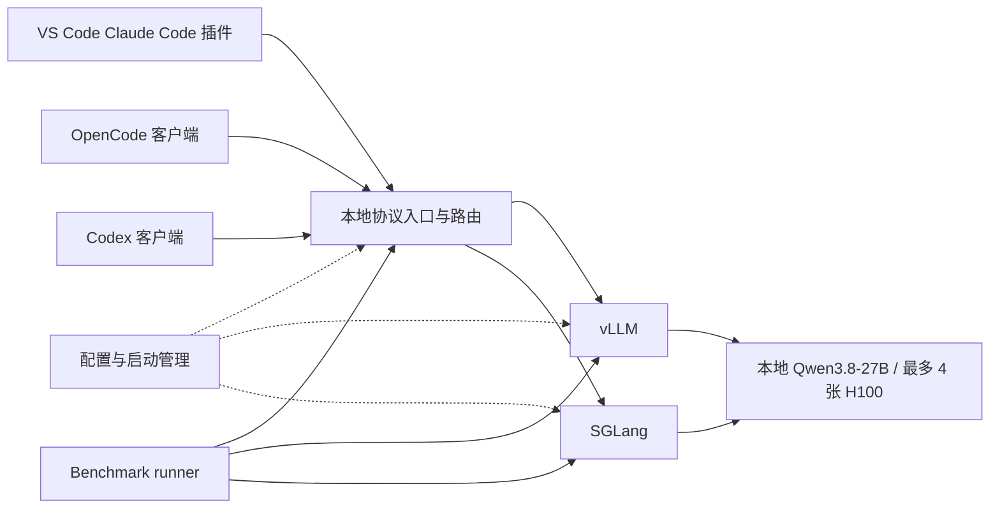

# PetitCoding v0.0.1 实施计划

状态：实施中。日期：2026-11-16。用户确认 1M 非首版硬要求；优先尝试官方 Claude Code VS Code 扩展，不可行时可使用 OpenCode。

## 1. 目标与边界

搭建本地 coding agent 使用环境：本机部署模型，用户从 VS Code 的 Claude Code 插件发起任务，由客户端 agent 执行读文件、修改代码、运行命令等操作，本地推理服务提供模型能力。复用现有 agent 客户端，不在首版自研完整 agent 执行框架。

硬性约束：

- 固定模型目录：`/share-mixed/project/eai_pwm/models/Qwen3.8-27B`。
- 最多使用本机 4 张 H100，不依赖外部模型 API。
- 权重与主要计算使用 BF16；KV cache 使用 BF16；禁止 FP8、INT8、INT4 等降低精度的部署。模型要求的 FP32 累加或 recurrent state 保留 FP32。
- 至少支持 262,144 tokens 总上下文，优先争取 1,000,000 tokens。
- 前端支持 Claude Code、OpenCode、Codex 等选型；后端支持 vLLM、SGLang 等选型，通过配置组合，而非修改代码切换。
- 提供模型服务在不同并发度下的可复现 benchmark。

本地部署指模型推理和项目适配服务运行在本机；VS Code 可以运行于本机，也可以通过 Remote SSH 使用服务器工作区。是否要求安装后完全断网，见待讨论项。

首版以文本 coding 工作流为范围，暂不承诺视觉输入、多机推理、模型训练、跨客户端会话迁移或所有客户端专有云功能。

## 2. 已知事实与待验证条件

已只读查看本地模型的 `config.json` 和 `README.md`：

| 项目 | 本地文件内容 | 对计划的影响 |
| --- | --- | --- |
| 架构 | `Qwen3_5ForConditionalGeneration`，64 层，混合线性注意力与全注意力 | 不能仅按目录名称判断引擎兼容性；必须验证该权重、chat template、工具解析器的组合 |
| 原生上下文 | `max_position_embeddings=262144` | 256K 基线无需自行发明上下文扩展方法 |
| 扩展上下文 | README 声明可扩展至 1,000,000，并提供 YaRN 参数 | 1M 有模型侧配置依据，部署容量与质量仍需实测 |
| 精度 | `dtype=bfloat16`，`mamba_ssm_dtype=float32` | 使用 BF16，保留必要的 FP32 状态 |
| 全注意力配置 | 16 层，4 个 KV heads，head dimension 为 256 | 用于初步估算长上下文 KV 显存 |
| 推理模式 | 默认 thinking，支持 `reasoning_effort`、`preserve_thinking` | 需验证客户端、协议适配和引擎能够正确传递并保留相关语义 |

尚未检查 GPU 型号细分、单卡显存、可用容量、NVLink/PCIe 拓扑、驱动、CUDA 和已有软件版本；不能假定 H100 一定为 80GB，也不能承诺特定吞吐或并发上限。

Claude Code 官方网关文档明确表示，不支持通过网关将请求路由到非 Claude 模型。因此“Claude 插件 + Qwen”应视为需要维护兼容性的集成目标，不作为官方支持能力宣传，也不能仅凭 HTTP 接口相通就宣布完成。[官方说明](https://code.claude.com/docs/en/llm-gateway)

## 3. 总体架构



图中后端为可选运行实例，不默认同时部署两套占用 GPU。工具执行留在客户端 agent 所在的工作区环境；模型服务与网关不代替客户端执行 shell。

分为四个可替换层：

1. **客户端配置层**：生成或说明各客户端的 endpoint、鉴权、模型名、上下文窗口配置。Claude Code 的 VS Code 插件是首要入口；其他客户端分别记录兼容性状态。
2. **协议入口层**：按需要提供 Anthropic Messages、OpenAI Chat Completions、OpenAI Responses 等协议。先评估引擎原生接口或已有适配组件；只有明确存在缺口时才实现最小适配。
3. **推理后端层**：为 vLLM、SGLang 提供各自启动配置和能力校验，统一模型别名、精度与上下文策略。
4. **运行与评测层**：负责启动、停止、健康检查、资源归属、版本记录、性能采集与结果导出。

每个客户端声明其实际需要的协议和功能，不能假定 OpenAI-compatible 等同于同时支持 Chat Completions 与 Responses。无法满足的组合应显式报错，禁止静默切换远程模型。

## 4. 模型部署与长上下文方案

### 4.1 基线与候选布局

以 vLLM、4 GPU tensor parallel、BF16、262,144 上下文作为初始候选；SGLang 使用相同模型和资源预算对照。最终默认引擎由兼容性、质量与 benchmark 结果共同决定，不预先承诺 vLLM 更快。

按容量逐步评估 TP=1、2、4；不适配的布局标记为容量不足。先完成单实例，再考虑多个副本提高短上下文吞吐；任何组合累计不得超过 4 张卡。

固定引擎版本或 commit、容器摘要、CUDA/PyTorch/Transformers 版本与启动参数。两个引擎可以使用独立环境，不强求共享依赖。仅加载文本能力是否可用，须按所选引擎版本确认，不能未经验证删除模型文件。

### 4.2 显存预算

27B 参数的 BF16 权重粗估约 54 GB（约 50.3 GiB）；实际包含视觉模块、加载布局等差异，以权重元信息与运行占用为准。

按本地配置，全注意力 KV cache 的逻辑容量估算为：

`tokens × 16 层 × 2(K/V) × 4 KV heads × 256 head_dim × 2 bytes`

| 单请求总驻留 tokens | 全注意力 BF16 KV 粗估 |
| --- | --- |
| 262,144 | 16 GiB |
| 524,288 | 32 GiB |
| 1,000,000 | 约 61.0 GiB |

这些是跨 GPU 的逻辑总量，不是每卡实占用；也不包含线性注意力状态、状态检查点、视觉模块、激活、CUDA graph、通信缓冲、缓存分块碎片及运行时预留。TP 下实际分片、复制方式必须核对。不同请求长度与并发会共同决定容量，不能只根据权重能放入显存就认定 1M 可用。

### 4.3 上下文档位

- `native-256k`：262,144 tokens，原生 RoPE，作为首版必达基线。
- `extended-512k`：524,288 tokens，按模型说明使用 YaRN factor=2，作为容量与质量的中间档。
- `extended-1m`：1,000,000 tokens，按模型说明使用 YaRN factor=4，优先实现，验证后再决定是否设为默认。

扩展配置通过引擎启动覆盖项传入，不修改共享模型目录。保留模型说明中的 `original_max_position_embeddings=262144` 及其他 RoPE 字段；具体参数名按固定版本校验。本地 README 已分别给出 vLLM 的 `--hf-overrides` 与 SGLang 的 `--json-model-override-args` 示例。

上下文上限包含系统提示、工具定义、历史消息、工具结果、thinking 和最终输出。调度时预留输出预算；例如 256K 档可规划 245,760 输入预算与 16,384 输出预算。客户端实际编码开销以最终 chat template 的 token 数为准。1M 总窗口不代表能输入 1M 后继续输出。

静态 YaRN 可能影响短文本质量，因此保留原生档位，不直接用 1M 配置替换所有场景。通过 chunked prefill、批处理 token 预算和最大活跃序列数控制资源；具体开关以混合架构支持情况为准。前缀缓存、状态缓存与抢占恢复需单独验证，不能照搬纯 Transformer 假设。

超过容量时排队或明确拒绝，不通过降低精度或静默截断达成“支持”。1M 的验收要覆盖实际推理和长文本质量，不能只检查启动参数。

## 5. 客户端与协议兼容

Claude Code 集成优先核对插件版本、配置读取位置、环境变量继承、登录路径、自定义 endpoint、模型别名与窗口声明。VS Code 本地窗口和 Remote SSH 窗口分别说明入口运行位置；需要时通过 SSH 端口转发连接服务器 localhost。[VS Code 官方文档](https://code.claude.com/docs/en/vs-code)

协议适配至少覆盖：

- 流式文本、事件顺序、结束原因、usage、错误与取消传播。
- 工具 schema、工具选择、增量 JSON 参数、tool call ID 与工具结果关联，多轮工具调用及多个工具调用。
- reasoning/thinking 的独立解析与历史回传；不伪造 Claude 特有的签名或语义。
- token 计数、上下文溢出、输出上限、超时、客户端重试及连接中断。
- 不支持的图片、缓存控制、结构化输出等能力明确拒绝或按文档降级，不能静默丢弃关键内容。

应记录“客户端 × 协议入口 × 后端 × 上下文档位”的支持矩阵及固定版本。v0.0.1 目标为 Claude Code、OpenCode、Codex 均有配置入口，vLLM 与 SGLang 均有后端配置；逐组合验证后声明支持，未通过项列为限制。Claude 插件优先；若实际验证不可行，按用户确认采用 OpenCode 作为替代入口，并记录原因。

## 6. 配置设计

建议使用 YAML，划分模型、后端、客户端、部署 profile 和 benchmark profile。通过显式引用组合，避免复制多份模型与端口配置。以下仅为 schema 草案，不代表现在生成任何可执行配置：

```yaml
schema_version: 1
model:
  path: /share-mixed/project/eai_pwm/models/Qwen3.8-27B
  served_name: petit-qwen
  dtype: bfloat16
  kv_cache_dtype: bfloat16
  quantization: null
deployment:
  backend: vllm                 # vllm | sglang
  gpu_ids: [0, 1, 2, 3]
  tensor_parallel_size: 4
  context_profile: native-256k
  max_model_len: 262144
  max_output_tokens: 16384
  max_active_sequences: 1       # 保守起点，后续按实测调整
frontend:
  type: claude                 # claude | opencode | codex
  endpoint_ref: local-anthropic
  model: petit-qwen
benchmark:
  concurrency: [1, 2, 4, 8, 16, 32]
  seed: 42
```

配置优先级建议为：公共默认值 < 模型配置 < 后端/客户端配置 < 命名 profile < 命令行显式覆盖。密钥通过环境变量或权限受控的本地文件注入，不提交 Git。

启动前执行静态校验：GPU 数不超过 4、TP 与设备一致、精度符合约束、上下文覆盖设置完整、协议能力匹配、端口无冲突。backend-specific 参数独立命名空间保存，不将 vLLM 参数原样传给 SGLang。提供最终生效配置和命令的预览，未知字段报错。

建议后续目录：`configs/{models,backends,frontends,profiles,benchmarks}/`、`src/`、`scripts/`、`benchmarks/`、`docs/`。具体命令与实现语言在开发阶段确定。

## 7. Benchmark 计划

### 7.1 分层评测

1. **后端直连**：测模型部署本身，排除网关和 agent 工具耗时。
2. **经过协议入口**：使用同一工作负载，量化协议转换、流式转发与排队开销。
3. **真实 coding 工作流**：另行衡量任务完成率、工具调用正确性和端到端耗时，不与纯推理 tok/s 混为一项。

### 7.2 工作负载矩阵

| 维度 | 计划档位 |
| --- | --- |
| 后端 | vLLM、SGLang，固定各自版本 |
| GPU 布局 | TP=1/2/4，先做容量筛选 |
| 上下文配置 | 256K、512K、1M |
| 输入长度 | 4K、32K、128K、接近各档最大输入预算 |
| 输出预算 | 512、2K、8K；窗口边界另设固定预算 |
| 并发度 | 1、2、4、8、16、32，达到资源边界后停止扩大 |
| 前缀缓存 | 关闭或冷缓存、固定共享前缀热缓存，分别报告 |
| 推理模式 | thinking 开/关分别报告，保留历史策略固定 |

不直接跑全部笛卡尔积：先用 4 GPU 和代表性输入筛选，再细化有价值的布局。长上下文先并发 1，再逐级提高；不可行组合记录 OOM、拒绝、超时或容量限制，禁止悄悄缩短输入。区分客户端在途并发、服务端活跃序列数与队列长度。

使用精确 token 数的合成请求测容量，使用固定版本的代码/仓库文本测代表性性能；记录 tokenizer、chat template、数据摘要及编码后的实际输入长度。避免依靠大量重复填充与意外缓存命中产生失真的吞吐结果。

### 7.3 指标与复现

- TTFT、每输出 token 时间/TPOT、流式 token 间隔和端到端延迟，报告 p50/p95/p99。
- 输入/输出吞吐分开统计，输出吞吐使用整轮墙钟时间；同时报告请求吞吐、实际输出长度和成功率。
- thinking tokens 与可见答案 tokens 分开统计；接口未暴露的指标标为不可得。
- GPU 峰值显存、利用率、功耗，以及 CPU/RAM、队列等待、OOM、错误和超时。
- 闭环并发测试用于并发曲线；补充按到达率施压的开环测试，用于识别排队饱和点。

先预热再采样，每个关键配置至少重复 3 轮，设置固定种子、采样参数、超时与请求预算。短请求积累足够样本；1M 高成本请求可减少样本，但必须披露样本数与波动，小样本不宣称可靠的 p99。冷启动与稳态分别报告，缓存条件一致后再比较后端。

输出原始逐请求 JSONL、汇总 CSV/JSON、Markdown 报告与曲线；附硬件拓扑、完整生效配置、软件版本、模型配置/模板摘要、运行时间、失败原因。报告给出不同上下文下的推荐并发和容量边界，不预先编造性能结果。

## 8. 后续实施阶段与验收

以下均为后续开发阶段工作，本次不执行。

| 阶段 | 交付物 | 完成条件 |
| --- | --- | --- |
| P0：环境与兼容性确认 | 硬件清单、版本候选、客户端协议清单 | 明确 GPU 容量和拓扑，找到支持本地权重与模板的引擎版本，确认 Claude 插件接入路径 |
| P1：BF16 原生部署 | 两种后端的启动配置与运行文档 | 不超过 4 张 H100，以 BF16 完成真实 256K 窗口请求并产出结果 |
| P2：VS Code agent 闭环 | Claude 插件配置、必要协议适配 | 在真实插件完成读文件→修改文件→运行命令→读取结果→继续修改，支持流式输出与取消 |
| P3：配置组合 | schema、profile、支持矩阵、配置预览 | 三类客户端和两类后端有配置入口；声明支持的组合均完成对应验证 |
| P4：上下文扩展 | 512K/1M profile、容量及质量报告 | 1M 在 BF16、最多 4 卡下完成真实边界请求，并验证跨位置检索与代码依赖理解；失败则明确阻塞因素 |
| P5：并发 benchmark | runner、原始数据、汇总与推荐配置 | 两种后端在相同条件下产出多个并发档位结果，含失败记录和可复现配置 |

质量验证应包含长文档多位置、多线索检索及跨文件代码任务；简单 needle 检索不足以证明 1M coding 可用。对比原生与 YaRN 档位在短任务上的退化。具体质量阈值与延迟 SLO 在用户给出场景后固定。

首版硬门槛：本地模型、最多 4 卡、BF16、256K、可用的 coding agent 入口、可配置前后端和多并发 benchmark；优先 Claude 插件，必要时采用 OpenCode。1M 为优先扩展目标；未达到时必须披露，不能以“配置可启动”代替验收。

## 9. 运行策略

默认监听 localhost，远程 VS Code 使用明确的转发地址；如需局域网多人访问，再配置鉴权与访问范围。服务停止只处理本项目管理的进程。日志默认记录请求元信息与性能，不持久化完整仓库代码、密钥或 thinking 内容。

客户端执行命令沿用其权限与确认机制；项目不默认取消工作区限制。依赖安装阶段可联网与运行时推理不调用外部模型是两个独立要求，按用户最终确定的离线范围处理。

## 10. 待讨论事项

以下问题不妨碍先保留本计划，但会影响后续实现与验收：

1. **Claude 插件具体指哪一个？** 暂按 Anthropic 官方 Claude Code VS Code 扩展理解。鉴于非 Claude 模型不受官方支持，如果固定版本仍无法稳定接入，是否接受 OpenCode 等作为临时入口？原要求在获得确认前继续保留。
2. **H100 的规格与使用预算？** 单卡显存、SXM/PCIe、互联，以及是否允许独占 4 卡。开发开始时可以只读检查，无需现在运行部署。
3. **并发与体验优先级？** 主要是单人长上下文 coding，还是多人共享？可接受的首 token 等待时间、生成速度与目标并发分别是多少？暂以单人正确性优先，再寻找吞吐拐点。
4. **1M 的优先级？** 当前按“256K 硬门槛，1M 优先争取”安排；若 1M 必须首版交付，需要将其改为阻塞验收条件。
5. **离线范围？** 是否仅要求本地推理，还是客户端登录、遥测、更新、依赖安装也都不得访问外网？这会直接影响官方插件的适用性。
6. **其他客户端的交付范围？** 暂定 OpenCode/Codex 都提供可选择配置，并对声明支持的组合验证；是否要求首版所有客户端与两个后端的完整组合均通过？

## 11. 依据

- 本地模型事实与长上下文参数：`/share-mixed/project/eai_pwm/models/Qwen3.8-27B/config.json`、同目录 `README.md`，已在编写计划时只读核对。模型目录名与架构名称不同不作为错误处理。
- [Claude Code 网关文档](https://code.claude.com/docs/en/llm-gateway)：网关接入与非 Claude 模型支持边界。
- [Claude Code VS Code 文档](https://code.claude.com/docs/en/vs-code)：插件使用与配置入口，具体版本兼容性留待实施确认。
- [SGLang OpenAI-compatible API 文档](https://docs.sglang.io/docs/basic_usage/openai_api)：仅作为协议入口依据，不推导所有客户端均可直接使用。
- 本地模型 README 指向的 [vLLM Qwen3.8 recipe](https://recipes.vllm.ai/Qwen/Qwen3.8-27B) 与 [SGLang Qwen3.8 cookbook](https://docs.sglang.io/cookbook/autoregressive/Qwen/Qwen3.8-27B)：后续选定版本时再核对，本文未据此承诺实际运行结果。
